I build AI products for Saudi businesses, and I post about AI and tech in Arabic for 6K+ followers. I founded **Mudeef**, and I study Computing and Software Systems, specialising in AI, at the University of Melbourne on an SDAIA AI scholarship.

**Open to internships and freelance AI work.**

أبني منتجات ذكاء اصطناعي للشركات السعودية، وأشارك رحلتي في الذكاء الاصطناعي والتقنية بالعربي على تيك توك وإنستغرام.

### I post about AI and tech, in Arabic

### Now

Mudeef's code is private. The projects below are open.

### Open work

